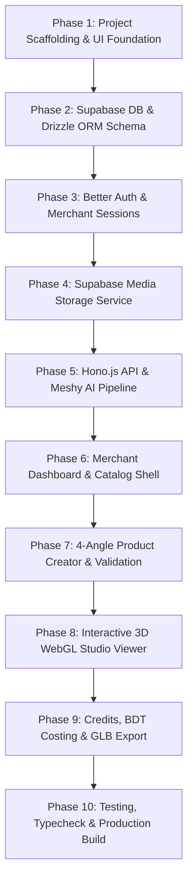

# Minimal Merchant 3D Studio — Vertical Phase Implementation Plan

This implementation plan is organized into **Vertical Phases**. Each phase delivers a complete, independently testable, end-to-end slice of functionality, moving progressively from core foundation to full production-ready MVP.

---

---

## Phase 1: Project Scaffolding & UI Foundation
**Objective:** Initialize the Next.js App Router application with TypeScript, Tailwind CSS, shadcn/ui design tokens, Lucide icons, and base configurations using pnpm.

- [ ] Initialize Next.js project with TypeScript, ESLint, and Tailwind CSS.
- [ ] Configure `pnpm` workspace and resolve package lock dependencies.
- [ ] Install and configure shadcn/ui components (`button`, `card`, `dialog`, `badge`, `input`, `select`, `table`, `tabs`, `skeleton`, `toast`, `dropdown-menu`).
- [ ] Set up curated aesthetic theme: warm neutral backgrounds, dark charcoal typography (`hsl(222 47% 11%)`), subtle borders (`hsl(214 32% 91%)`), and an elegant accent color.
- [ ] Create `.env.example` with full configuration templates.
- **Verification:** Development server boots cleanly with `pnpm dev`, rendering a polished design system demonstration page.

---

## Phase 2: Supabase DB & Drizzle ORM Schema
**Objective:** Model the relational schema in Drizzle ORM, establish connection pooling to Supabase PostgreSQL, and configure automated migrations.

- [ ] Install `drizzle-orm`, `drizzle-kit`, and `postgres` / `@neondatabase/serverless`.
- [ ] Configure `drizzle.config.ts` and database client singleton in `lib/db/index.ts`.
- [ ] Define relational schemas:
  - `users` & `sessions` (Better Auth compatible).
  - `products` (Dimensions in `mm`, category, status).
  - `product_images` (4 angle views: `front`, `back`, `left`, `right`, storage paths, public URLs).
  - `generation_attempts` (Provider task tracking, credit cost, status, error states).
- [ ] Write migration generation script and initial migration runner.
- **Verification:** Execute migration command successfully; verify tables and relational foreign keys against PostgreSQL.

---

## Phase 3: Better Auth & Merchant Sessions
**Objective:** Establish secure session handling with Better Auth, Drizzle adapter, and a streamlined "One-Click Demo Merchant" access mode.

- [ ] Install `better-auth` and configure `lib/auth/auth.ts`.
- [ ] Bind Better Auth to Drizzle ORM schema.
- [ ] Implement Next.js App Router auth route handler (`app/api/auth/[...all]/route.ts`).
- [ ] Build Auth UI: Clean login/register page with an instant **"Enter as Demo Merchant"** button for quick testing without credentials friction.
- [ ] Implement client-side session hooks and navigation bar merchant avatar.
- **Verification:** Login/logout flow functions smoothly; session cookies persist; merchant ID correctly links to subsequent product records.

---

## Phase 4: Supabase Media Storage Service
**Objective:** Build a robust, type-safe cloud storage layer to upload and serve the 4 angle photographs and generated 3D `.glb` models.

- [ ] Install `@supabase/supabase-js`.
- [ ] Implement `lib/storage/supabase-storage.ts` with clean abstract methods:
  - `uploadProductImage(file, productId, viewType)`
  - `uploadModelFile(buffer, productId, filename)`
  - `getPublicUrl(path)`
  - `deleteProductAssets(productId)`
- [ ] Set up client-side and server-side file format validation (JPEG, PNG, WebP) and 20MB file size checks.
- **Verification:** Upload sample test images and verify public URL generation, MIME types, and deletion endpoints.

---

## Phase 5: Hono.js API & Meshy AI Pipeline
**Objective:** Implement high-speed Hono backend routes with Zod validation, Meshy Multi-Image-to-3D client, and asynchronous task polling.

- [ ] Install `hono` and `@hono/zod-validator`.
- [ ] Mount Hono on Next.js API route handler (`app/api/[[...route]]/route.ts`).
- [ ] Implement Meshy API client (`lib/meshy/client.ts`):
  - Request format: `POST /openapi/v1/multi-image-to-3d` with 4 image URLs.
  - Parameters: `should_texture: true`, `texture_resolution: "2k"`, `enable_pbr: true`, `model_type: "standard"`.
  - Task Polling: `GET /openapi/v1/multi-image-to-3d/{task_id}` with exponential backoff and timeout safeguards.
- [ ] Create API endpoints:
  - `POST /api/products`: Create product metadata and associate image records.
  - `POST /api/products/:id/generate`: Initiate Meshy generation, save `provider_task_id`, set status to `processing`.
  - `GET /api/products/:id/status`: Poll task progress and retrieve output GLB URL when ready.
  - `POST /api/products/:id/retry`: Trigger a new generation attempt preserving prior history.
- **Verification:** Integration tests with mocked Meshy API responses verify status transitions: `queued` ➔ `processing` ➔ `completed` / `failed`.

---

## Phase 6: Merchant Dashboard & Catalog Shell
**Objective:** Deliver the primary merchant dashboard with real-time statistics, active product catalog, filtering, and deletion workflows.

- [ ] Build responsive application shell:
  - Persistent Desktop Sidebar + Mobile Hamburger Sheet.
  - Top header with Breadcrumbs, Live Demo Credits badge, and "Create 3D Model" button.
- [ ] Build **Overview Page** (`/dashboard`):
  - 4 Key Metric Cards: Total Products, Models Generated, Currently Processing, Failed.
  - Recent Products preview grid with generation status tags.
  - Empty state with prominent "Create your first 3D model" CTA.
- [ ] Build **My Products Page** (`/dashboard/products`):
  - Product Card grid with thumbnail, dimensions (in cm/mm), category badge, and status pill.
  - Real-time search by product name and filtering by Category & Generation Status.
  - Delete product confirmation modal (with warning that cloud assets will be purged).
- **Verification:** Dashboard renders live data from PostgreSQL, search and filter states respond instantaneously.

---

## Phase 7: 4-Angle Product Creator & Validation
**Objective:** Create the dedicated 4-angle image upload wizard with real-world dimension validation, duplicate image detection, and pre-generation review modal.

- [ ] Build **Create Product Form** (`/dashboard/create`):
  - Product Name, Category dropdown, and optional description.
  - Real-world Dimensions: Width, Depth, Height with unit toggle (`cm` / `mm`), normalizing to `mm` behind the scenes.
- [ ] Build **4-Slot Dedicated Image Dropzone**:
  - Individual slots: Front, Back, Left, Right.
  - Drag-and-drop support, native file selector, instant preview thumbnail.
  - Duplicate file warning if the same image is picked for multiple angles.
  - Replace and Remove actions per slot.
- [ ] Build **Pre-Generation Review Modal**:
  - Grid preview of all 4 perspectives.
  - Normalized dimension readout.
  - Estimated credit cost breakdown.
  - "Generate 3D Model" action with double-click submission prevention.
- **Verification:** Complete form submission sends 4 images to Supabase Storage, records product metadata in DB, and transitions directly to generation tracking.

---

## Phase 8: Interactive 3D WebGL Studio Viewer
**Objective:** Implement a high-performance WebGL 3D viewer using Three.js / React Three Fiber for interactive model inspection.

- [ ] Install `three`, `@types/three`, `@react-three/fiber`, and `@react-three/drei`.
- [ ] Build `<StudioCanvas>` component:
  - GLB loader with suspense skeletons and percentage progress bar.
  - Smooth OrbitControls (360° rotation, zoom, pan, polar angle constraints).
  - Studio Lighting rig: soft ambient light, key directional light, contact shadows on the floor.
  - Camera Controls: "Fit to View", "Reset Camera", and backdrop toggle (Studio Neutral / Transparent).
  - Floating dimension info badge (Width × Depth × Height).
- [ ] Memory Leak Safeguards: Ensure geometries, textures, and canvas WebGL contexts are properly disposed when leaving the page.
- **Verification:** Load authentic furniture `.glb` model; verify smooth 60fps rendering, lighting reflections, and orbit interaction.

---

## Phase 9: Credits, BDT Costing & GLB Export
**Objective:** Provide model export capabilities, retry flows, and complete transparency into Meshy AI usage and BDT currency estimates.

- [ ] Implement **Download GLB Action**:
  - Fetch model blob from Supabase Storage / object URL.
  - Trigger client download with sanitized filename (`[product-name]-3d-model.glb`).
- [ ] Build **Credits & Usage Page** (`/dashboard/credits`):
  - Summary metrics: Total Attempts, Successful Generations, Failed Attempts, Credits Used.
  - Cost in Bangladeshi Taka (BDT) calculation based on configurable exchange rate (`USD_TO_BDT_RATE`).
  - Generation audit log table with timestamps, status badges, and retry buttons.
- [ ] Build **Retry Generation Flow**:
  - Retrying creates a new row in `generation_attempts` while preserving the historical attempt.
- **Verification:** Trigger GLB download and confirm file integrity; verify BDT calculation math updates accurately with generation events.

---

## Phase 10: Testing, Typecheck & Production Build
**Objective:** Verify system reliability, run automated test suites, linting, type safety checks, and produce a production-ready Next.js build.

- [ ] Write Vitest / Jest unit tests for:
  - Dimension normalization (`cm` ➔ `mm`) and Zod schema validations.
  - Duplicate image detection utility.
  - BDT currency conversion calculator.
  - Meshy client polling backoff and retry bounds.
- [ ] Run `pnpm lint` and resolve all ESLint rules.
- [ ] Run `pnpm tsc --noEmit` to ensure strict TypeScript type safety.
- [ ] Execute `pnpm build` to verify production Next.js bundling.
- [ ] Create documentation on environment setup and operational instructions.
- **Verification:** Zero type errors, all tests pass, and `pnpm build` produces an optimized standalone bundle.
